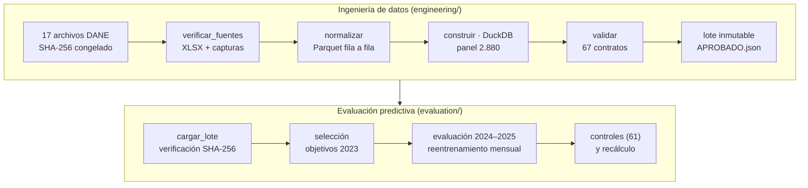
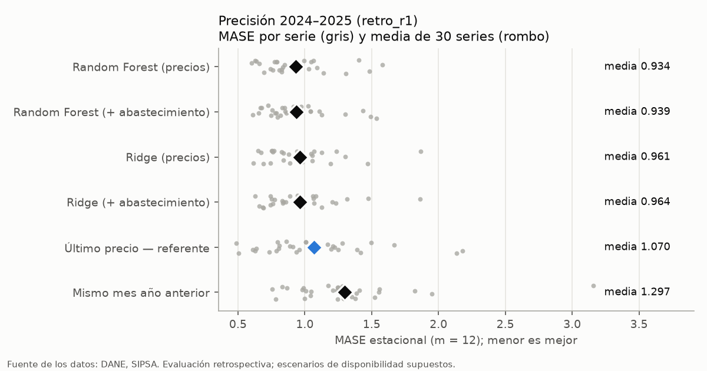
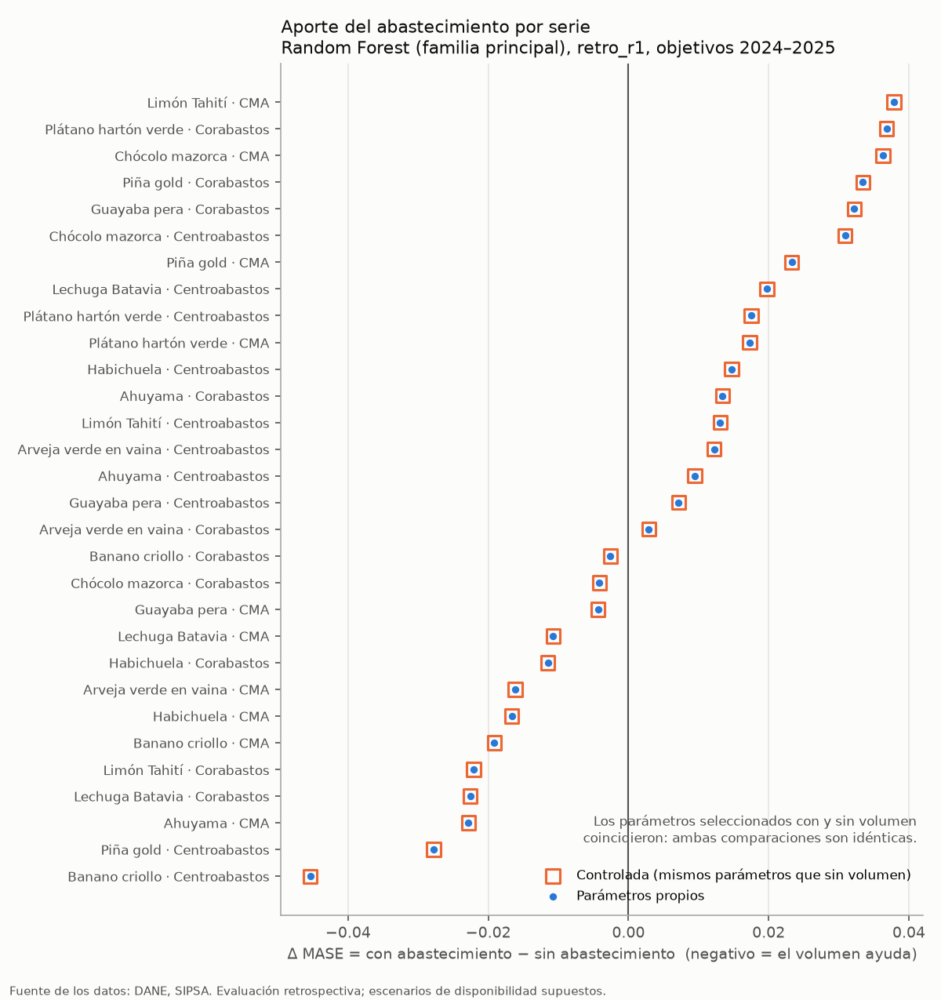
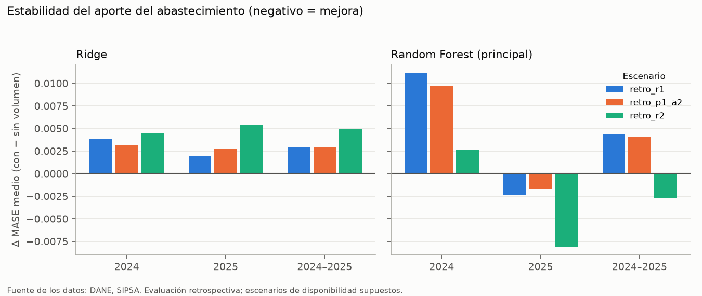

# Pronóstico de precios mayoristas en Colombia: evaluación del aporte del abastecimiento

**Autor:** David Bonilla · **Etapa 1:** evaluación retrospectiva (2026) · **Datos:** DANE, Sistema de Información de Precios y Abastecimiento del Sector Agropecuario (SIPSA)

> **Resultado en una frase.** En este experimento, los precios históricos mejoran el pronóstico promedio frente al último precio conocido; añadir abastecimiento rezagado no ofrece una mejora material observada. La mejora es desigual entre productos y mercados.

## 1. Problema

Un comprador mayorista que planifica su presupuesto mensual necesita anticipar el precio del mes siguiente. La pregunta de esta etapa es:

**¿Mejora el pronóstico mensual del precio mayorista si, además de los precios históricos, se usa el volumen de abastecimiento rezagado?**

Responderlo evita añadir una fuente de datos y complejidad que no mejoren el pronóstico. La utilidad para compras es **potencial**: todavía no se validó con compradores ni con una regla de decisión.

## 2. Datos

| | |
|---|---|
| Fuente | DANE–SIPSA: series históricas de precios mayoristas y microdatos de abastecimiento, 2018–2025. Son 17 archivos oficiales con SHA-256 congelado. |
| Volumen de origen | 439.895 registros de precios y 15.494.712 de abastecimiento. Se procesaron completos para construir el panel; **no son observaciones de entrenamiento**. |
| Panel analítico | 10 productos × 3 mercados × 96 meses = **30 series y 2.880 combinaciones producto–mercado–mes** |
| Mercados | Corabastos (Bogotá), Central Mayorista de Antioquia (Medellín), Centroabastos (Bucaramanga) |
| Productos | chócolo mazorca, arveja verde en vaina, lechuga Batavia, habichuela, ahuyama, piña gold, limón Tahití, guayaba pera, banano criollo, plátano hartón verde. Se seleccionaron por cobertura y volumen de 2018–2022, sin mirar los resultados. |
| Faltantes | 2 precios ausentes en la fuente (limón Tahití, Centroabastos, 2025-04 y 2025-09), conservados como ausentes |
| Ejemplos de modelación | En el escenario principal, 2.400 combinaciones tienen ventanas completas. En cada mes se entrena con 1.650 a 2.338 filas y se evalúan 718 objetivos de 2024–2025. |

**Este repositorio no redistribuye las series del DANE.** Las condiciones de los catálogos SIPSA exigen visto bueno escrito para reproducirlas electrónicamente para múltiples usuarios. Por eso aquí se publican código, metodología, métricas agregadas y figuras, y las series se obtienen del DANE y se reconstruyen localmente con huellas verificadas. Detalles en [ATRIBUCION_DATOS.md](ATRIBUCION_DATOS.md) y [docs/datos_y_procedencia.md](docs/datos_y_procedencia.md).

## 3. Estrategia

- **Ingeniería trazable** ([engineering/](engineering/); módulos `sipsa.lote`, `sipsa.normalizar`, `sipsa.construir`, `sipsa.validar`). Cada precio y volumen conserva su archivo, hoja y fila de origen. Los lotes se publican de forma atómica y pasan 67 contratos de integridad.
- **Calendario.** El pronóstico se emite al cierre del mes `t` para `t+1`.
  - En el escenario principal (`retro_r1`) se conocen precios y volúmenes hasta `t−1`.
  - Hay dos escenarios alternativos de retraso.
  - Los retrasos son **supuestos**: no hay fechas históricas de publicación verificadas.
- **Protocolo fijado antes de estimar** ([evaluation/PROTOCOLO_PREDICTIVO.md](evaluation/PROTOCOLO_PREDICTIVO.md)):
  - selección de parámetros con objetivos de 2023;
  - evaluación final 2024–2025 con parámetros congelados y reentrenamiento mensual;
  - métrica principal: MASE estacional, con igual peso por serie.
- **Modelos comparados:**
  - último precio conocido (referente elegido en 2023);
  - mismo mes del año anterior;
  - Ridge y Random Forest conjuntos, cada uno **con y sin** abastecimiento.
- **Controles contra información futura.** Pruebas que alteran los datos posteriores al corte, más auditoría de las fechas efectivamente usadas.

El detalle está en [docs/metodologia.md](docs/metodologia.md).

## 4. Resultados

| Escenario principal | MASE 2024–2025 | 2024 | 2025 |
|---|---|---|---|
| Último precio conocido (referente) | 1,070 | 1,121 | 1,017 |
| Random Forest, solo precios | **0,934** | 0,953 | 0,915 |
| Random Forest, precios + abastecimiento | 0,939 | 0,965 | 0,913 |

- **Random Forest con precios** reduce el MASE medio un **12,67 %** frente al último precio conocido: 14,97 % en 2024 y 10,00 % en 2025. Mejora 21 de 30 series en conjunto, pero solo 17 de 30 en 2025.
- **La mediana del MAE por serie empeora:** 497,44 frente a 481,73 COP/kg (≈ +3,26 %). La mejora promedio en MASE no se traslada a todas las series.
- **El error porcentual firmado medio** del Random Forest es +6,92 %. Indica sobreestimación en promedio, no en todas las series: 20 de 30 tienen error firmado positivo en COP/kg.
- **Añadir abastecimiento** cambia el MASE +0,47 % con Random Forest y +0,31 % con Ridge en el escenario principal, es decir, empeora ligeramente. En los escenarios alternativos los cambios también son pequeños: entre −0,25 % y +0,44 %. Ninguno alcanza el umbral práctico de ±2 %.

Las métricas agregadas están en [evaluation/resultados/](evaluation/resultados/) y se describen en [docs/diccionario_datos.md](docs/diccionario_datos.md). Las predicciones mes a mes contienen precios del DANE, no se distribuyen y se regeneran localmente. Una reducción del MASE no es una «tasa de aciertos»: mide cuánto menor es el error relativo frente a la escala de cada serie.

## 5. Utilidad potencial

Un pronóstico mensual con error medio menor que el último precio podría apoyar la **planificación presupuestaria** de compras mayoristas en estos productos y mercados. La heterogeneidad entre series y el sesgo observado hacen necesario elegir el método por serie y vigilar su desempeño. Ninguna de estas utilidades se ha validado con compradores.

## 6. Límites

- **Evaluación retrospectiva** con disponibilidad supuesta. No es un sistema productivo ni una validación con usuarios.
- **Sin inferencia estadística:** no hay intervalos ni pruebas. El umbral de ±2 % para llamar «material» un cambio es un criterio práctico interno, no una equivalencia estadística.
- **Alcance:** precio mayorista de 10 productos en 3 plazas; no son precios minoristas, gasto de los hogares ni todo el país.
- **No causal:** una asociación entre volumen y precio no identifica el efecto de la oferta.
- **Sin ahorros ni impacto comercial calculados:** falta una regla de compra con costos.
- **Alcance del resultado sobre el abastecimiento:** no demuestra que el volumen carezca de información en otros modelos, frecuencias o variables.

## 7. Reproducción

| Modo | Requisitos | Qué permite |
|---|---|---|
| **A. Explorar y comprobar** | Nada, o Python 3.12–3.13 con `evaluation/requirements.lock` | Leer resultados y figuras; verificar las huellas de los archivos; `python -m evaluacion verificar-publico` comprueba código, configuración, tablas aprobadas y su consistencia interna. Los controles que requieren series del DANE se informan como «NO EJECUTADO: requiere reconstrucción local». |
| **B. Reconstruir y validar** | Además, unos 750 MB de descarga del DANE y entre 10 y 15 minutos | Obtener las fuentes oficiales con huella verificada, reconstruir referencias, lote y predicciones localmente, y ejecutar el recálculo completo, los 61 controles y las pruebas de rechazo frente a los resultados aprobados |

Los comandos exactos están en [docs/reproduccion.md](docs/reproduccion.md). La validación realizada y su alcance se describen en [docs/validacion_y_revisiones.md](docs/validacion_y_revisiones.md).

## 8. Trabajo futuro (Etapa 2, pendiente)

- **Evaluación prospectiva:** capturas fechadas mensuales para evaluar con la información realmente disponible en cada fecha.
- **Piloto con compradores:** regla de decisión, costos y horizonte útiles para medir valor práctico, no solo error.
- **Ampliación científica:** inferencia sobre las diferencias con diseños que respeten la dependencia entre series, otras frecuencias y variables, y una nueva evaluación reservada si cambia la especificación.

## Fuentes y autoría

**Fuente: Departamento Administrativo Nacional de Estadística: [www.dane.gov.co](https://www.dane.gov.co)** (SIPSA). Las transformaciones y conclusiones son responsabilidad del autor; este proyecto no está afiliado al DANE ni cuenta con su respaldo. Análisis, código y documentación: David Bonilla. Condiciones de uso de los datos en [ATRIBUCION_DATOS.md](ATRIBUCION_DATOS.md).
